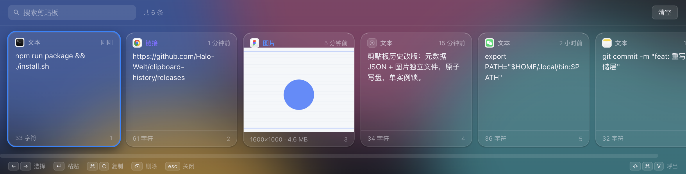
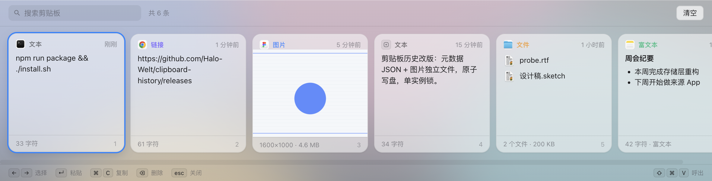

# Clipboard · 剪贴板历史

> **Clipboard** —— 一个为自己日常使用而做的 macOS 剪贴板历史小工具。已打包成原生 `.app`，**不需要终端常驻**。


## ✨ 功能

- 🎯 全局快捷键 **⇧⌘V** 呼出 / 隐藏
- 📋 自动监听剪贴板，自动去重：**文本 / 链接 / 图片 / 文件 / 富文本**
- 🔍 关键字搜索（内容、来源 App 名、文件名都能搜）
- ⌨️ 全键盘操作（← → 切换、Enter 粘贴、1-9 直选、⌘C 复制、Delete 删除、⌘F 搜索、Esc 关闭）
- 🏷 每条记录都带**来源 App 图标**（微信 / Chrome / 终端…）；iPhone/iPad 接力复制过来的内容显示 iCloud 剪贴板图标，搜索也能按 App 名过滤
- 🗂 复制文件（Finder 里选中的文件/文件夹）会记成「文件」卡片，显示每个文件的系统图标和大小，粘贴时原样放回剪贴板
- 🎨 带格式的文字记成「富文本」卡片，粘贴时保留加粗/斜体/列表等格式
- 💾 持久化存储，最多 200 条：元数据 JSON + 图片/富文本独立文件，原子写盘带 `.bak` 兜底
- ✨ 毛玻璃 vibrancy + 横向滑动卡片
- 🍎 隐藏 Dock 图标，仅菜单栏 📋 常驻
- 🔄 菜单栏可勾选「**开机自启动**」，一次配置永久生效
- ⚡ **直接粘贴到目标 App**：选中卡片后自动把焦点切回原 App 并模拟 ⌘V
- 🚀 **应用内一键自动更新**：发现新版后下载、解压、替换、重启全自动完成，无需手动操作

## 📦 安装

### 方式一：下载 Release（最简单，推荐）

前往 [Releases 页面](https://github.com/Halo-Welt/clipboard-history/releases) 下载最新的 `Clipboard-arm64.zip`：

```bash
# 解压
unzip Clipboard-arm64.zip

# 移动到应用程序文件夹
mv Clipboard.app /Applications/

# 移除 quarantine 标记（让未签名 App 可以直接打开）
xattr -cr /Applications/Clipboard.app

# 启动
open /Applications/Clipboard.app
```

> ⚠️ 当前 Release 仅提供 **Apple Silicon (arm64)** 架构。Intel Mac 用户请使用方式二自行编译。

### 方式二：从源码编译

```bash
# 克隆仓库
git clone https://github.com/Halo-Welt/clipboard-history.git
cd clipboard-history

# 安装依赖
npm install

# 打包成 .app
npm run package

# 一键安装到 /Applications（含 quarantine 处理）
./install.sh
```

`install.sh` 会自动：
1. 把 `Clipboard.app` 拷贝到 `/Applications/`（并清理改名前的 `ClipboardHistory.app`）
2. 移除 quarantine 标记，避免「无法验证开发者」拦截
3. 询问是否立即启动

之后从 **Launchpad** 或 **应用程序** 文件夹直接双击启动即可，无需任何终端依赖。

### 方式三：开发模式直接运行

```bash
git clone https://github.com/Halo-Welt/clipboard-history.git
cd clipboard-history
npm install
npm start
```

## 🔑 首次启动注意事项

1. **辅助功能权限**：模拟 ⌘V 自动粘贴需要"辅助功能"权限。
   - 系统设置 → 隐私与安全性 → 辅助功能 → 把 **Clipboard** 打钩
   - 没打钩的话，点击卡片只会复制到剪贴板，不会自动粘贴到目标 App
2. **未签名应用**：本应用没有 Apple 开发者签名，第一次双击若提示"无法验证开发者"，请：
   - 右键应用 → 选择"打开" → 弹窗中点"打开"
   - 或运行 `xattr -cr /Applications/Clipboard.app`（`install.sh` 已自动处理）

## ⌨️ 操作快捷键

| 按键 | 作用 |
|------|------|
| ⇧⌘V | 显示 / 隐藏窗口 |
| ← / → | 选择卡片 |
| Enter | 粘贴选中项 |
| 1-9 | 直接粘贴对应序号 |
| ⌘C | 复制选中项到剪贴板（不粘贴、不关闭窗口） |
| Delete / Backspace | 删除选中项 |
| ⌘F 或 / | 聚焦搜索框 |
| Home / End | 跳到第一张 / 最后一张 |
| Esc | 关闭窗口 |
| 右键卡片 | 删除该项 |

卡片左上角的小图标就是这条内容的来源 App；搜索框里直接输入 App 名（比如「微信」）就能只看它复制出来的内容。

## 🍎 菜单栏（点击 📋）

- 显示 Clipboard (⇧⌘V)
- 清空历史
- ☐ 开机自启动
- 检查更新...
- 当前版本：vX.Y.Z
- 关于
- 退出

## 🆕 自动更新机制（应用内一键完成 · 零打扰）

- 应用启动 5 秒后会**静默**向 GitHub Releases API 检查是否有新版本
- 之后每 6 小时复查一次
- **发现新版本时不会弹窗**，仅做两件低打扰提示：
  - 菜单栏 📋 标题加一个 `·` 红点提示
  - 点开菜单顶部多出 `🆕  立即更新到 vX.Y.Z` / 查看更新说明 / 跳过此版本 三个选项
- 用户主动点击「立即更新」后，才进入下载流程：
  - 显示进度条小窗（可拖动，毛玻璃风格）
  - **应用内自动下载、解压、替换、重启**，全程无需手动操作 ⚡
- 你也可以从菜单栏 📋 → **检查更新...** 手动触发；触发结果用 macOS 原生 toast 通知（右上角飞过），不打断当前工作

### 自动更新原理（针对未签名应用）

由于应用未走 Apple 开发者签名通道，无法用 Squirrel/electron-updater 的标准更新框架。本项目自实现了完整的应用内更新流程：

1. 调 GitHub Releases API 拿最新版本号 + zip 资产 URL
2. 下载到 `$TMPDIR`，带进度条窗口
3. `unzip` 解压，`xattr -cr` 移除 quarantine
4. 写一个 detached shell 脚本：
   - 等当前 App 进程退出（最多 30 秒）
   - 用 `ditto` 把新 `.app` 拷到 `/Applications/`
   - 原子替换旧版（先 mv 走再 mv 来）
   - `open` 启动新版
5. 当前 App 退出，脚本接力完成替换 → 自动启动新版

整个过程用户只需点一次「立即更新」按钮，30 秒后就在用新版本了。

## 📁 项目结构

```
.
├── main.js          # 主进程：快捷键、剪贴板监听、自启动、托盘
├── preload.js       # 预加载脚本（contextBridge）
├── index.html       # 渲染层入口（窗口加载的 HTML）
├── styles.css       # 毛玻璃 + 卡片样式
├── renderer.js      # 渲染层逻辑（搜索、键盘、卡片渲染）
├── assets/         # 菜单栏 template 图标（16/32/48px）
├── docs/           # 外观截图
├── build/
│   ├── icon.icns    # 应用图标（深色圆角方 + 卡片图形）
│   └── package.js   # 打包脚本（@electron/packager）
└── install.sh       # 一键安装到 /Applications
```

## 🔧 开发

```bash
npm start            # 开发模式启动（直接运行 electron .）
# 如果你的终端环境里带了 ELECTRON_RUN_AS_NODE（某些 IDE/工具链会注入），改用：
env -u ELECTRON_RUN_AS_NODE ./node_modules/.bin/electron .
npm run package      # 打包生成 .app（输出到 dist/）
./install.sh         # 把 dist/ 中的 .app 安装到 /Applications
```

## 🛠 技术栈

- [Electron 28](https://www.electronjs.org/) — Chromium + Node 跨平台框架
- [@electron/packager](https://github.com/electron/packager) — 打包工具
- macOS vibrancy + `LSUIElement`（无 Dock 图标）
- 来源识别：`lsappinfo` 读当前前台 App 的 bundle id 与 `.app` 路径（不需要辅助功能权限），图标用 `sips` 从 `.icns` 转 PNG 缓存到 `sources/`
- 本地持久化：`~/Library/Application Support/Clipboard/clipboard-history.json` 存元数据，同目录 `images/` 存原图与 480px 缩略图（自定义 `ch-image://` 协议按需加载缩略图，不再把 base64 塞进 JSON）
- `app.setLoginItemSettings` 实现开机自启

## 🖼 外观





## ⚡ 性能

空闲 CPU 约 0–0.3%，剪贴板里放着一张 4.6 MB 图片时也保持在同一水平（旧实现会升到 11–41%）：
剪贴板轮询先用几乎零成本的 `readText()` 判文本，只有在没有文本时才 `readBuffer('public.png')` 取原始字节算哈希，
只有哈希变化才解码缩略图。详见 [AUDIT.md](./AUDIT.md)。

## 📝 说明

本仓库是作者为自用而开发的 macOS 小工具，仅供个人学习与日常使用。代码以 MIT 协议开源，欢迎自行编译使用，但请勿将构建产物用于商业分发。

## 📜 License

[MIT](./LICENSE) © 2026 liuxinyu
